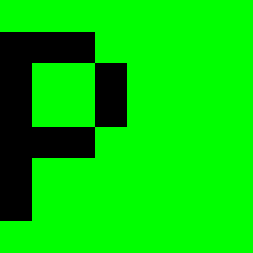

# 

**paxsy** — the toolchain for the Paxsy systems programming language:
a complete compiler frontend (lexer, parser, semantic analysis),
a clean-code linter, a project manager and a package manager, in one
small self-contained binary written in C99.

* Website: <https://paxsy.org>
* Documentation: [Toolchain User Manual](docs/ToolchainUserManual.md) ·
  [Command reference](docs/cli.md)

## Features

* **Full frontend pipeline** — tokenizing, parsing and semantic analysis
  of the whole project, with caret-underlined diagnostics in colour.
* **A real standard library** — `std::inout`, `std::string` and
  friends, written in Paxsy itself under [`std/`](std), installed into a
  local package cache and understood by the semantic analysis.
* **A package manager** — fetch, search, install, update, remove and list
  packages against the static repository at `paxsy.org`, with a local
  cache so everything also works offline.
* **Clean-code enforcement** — `paxsy clippy` checks the source against
  the style guide (`--fix`, `--strict`, `--Wextra`).
* **Project tooling** — minimal `init` (two files and a git repository),
  silent `build`/`check`, `tree`, `bench`, `doc`, `meta`, `config`,
  deterministic frontend archives (`state`/`shared`) for the upcoming
  code generation backend.
* **Editor support** — syntax highlighting for
  [Vim](editors/vim) and [VSCode](editors/vscode).

## Installation

One line, from the release server:

```sh
curl -fsSL https://paxsy.org/install.sh | sh
```

From a source checkout (no server needed) — builds, installs into
`~/.local` and loads the standard library:

```sh
scripts/install-dev.sh
```

Or pick one of the packaged routes: the AUR `PKGBUILD` for Arch Linux,
or `flake.nix` for Nix (`nix run` / `nix profile install`).

## Quick start

```sh
paxsy init hello
cd hello
paxsy check     # silence means success
paxsy build     # writes build/report.txt
paxsy clippy    # clean-code rules
```

A project is exactly two files — `src/main.px` (a greeting program) and
`hello.toml` — plus an initialised git repository.

## Building from source

```sh
make            # objects land in bin/, binary at ./paxsy
```

The build is plain C99 (`-std=c99 -Wall -Wextra`, warning-free) with no
dependencies beyond the C library and POSIX. `make clean` removes the
objects and the binary.

## Repository layout

```
paxsy/
├── src/                  the toolchain (C99, one binary)
├── std/                  the standard library (Paxsy)
│   ├── std.toml
│   └── src/              one .px file per module
├── scripts/install-dev.sh   developer installation
├── editors/              Vim and VSCode syntax highlighting
├── docs/                 ToolchainUserManual.md, cli.md
├── install.sh            release installer (paxsy.org)
├── PKGBUILD, flake.nix   packaged installs
└── Makefile
```

## Documentation

* [docs/ToolchainUserManual.md](docs/ToolchainUserManual.md) — the full
  manual: every command, the configuration file, the package
  repository protocol, the environment.
* [docs/cli.md](docs/cli.md) — a compact command reference.

## Contributing

Library development loop without any network: edit under `std/`, then

```sh
paxsy check std
scripts/install-dev.sh --libs-only
```

Style: four-space indentation, 80 columns, English identifiers and
comments; `paxsy clippy --Wextra` should stay quiet.

## License

MIT. See `paxsy --license`.
